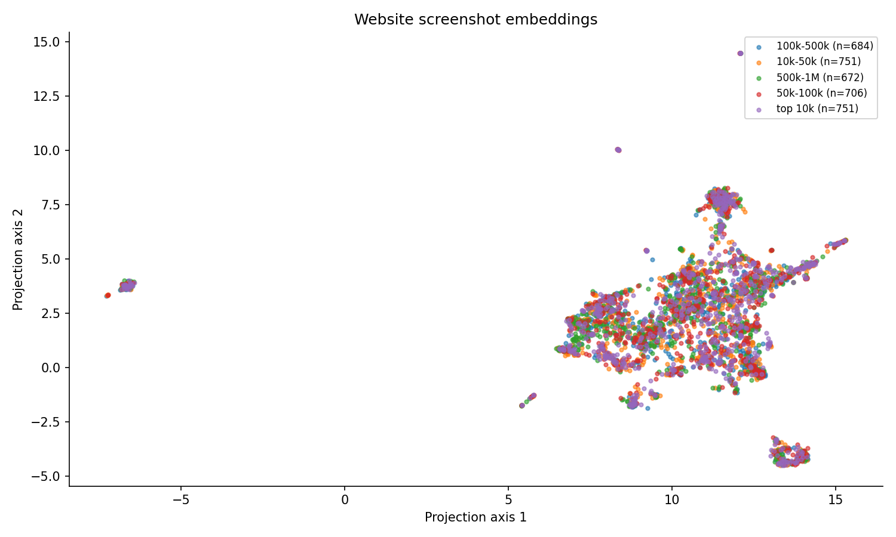

# Visual Map of 5,000 Websites

A Python project for comparing how websites look. It captures homepages, finds visually similar pages, groups them, and builds a map and a short research report.

Everything runs locally. No paid APIs or GPU are needed.



## What came out of the first run

- 5,000 domains attempted
- 3,970 screenshots captured
- 3,564 nonblank screenshots embedded
- A four-page report with findings and examples

Read the [results](RESULTS.md) or open the [report](reports/findings.pdf).

## Setup

Use Python 3.11. From the project folder:

```sh
python3.11 -m venv .venv
source .venv/bin/activate
python -m pip install -r requirements-lock.txt
python -m playwright install chromium
```

On Windows, use `.venv\Scripts\activate` to activate the environment. On Linux, you may need `python -m playwright install --with-deps chromium`.

The first model run downloads about 600 MB of weights. Leave a few GB of free disk space for the browser, screenshots, and dependencies.

## Run

The domain list is in `data/domains.csv`.

```sh
python run_pipeline.py
```

This runs the steps in order: validate the input, capture pages, check images, create embeddings, analyze them, and generate the figures and PDF. If it stops, run the same command again to resume.

The repo includes results and metadata from the completed run. Raw screenshots and NumPy vectors are kept outside Git because of their size. A fresh clone will capture missing images again. To retry previously failed sites too:

```sh
python src/capture.py --retry-failed
python run_pipeline.py --from-stage quality
```

For a small capture run, use `python run_pipeline.py --limit 30 --to-stage quality`. This attempts up to 30 pending domains; a completed local collection may have none left.

## Project layout

```text
data/          Domain list and review notes
screenshots/   Captured images
metadata/      Capture results, errors, hashes, and versions
embeddings/    Image vectors and their screenshot mapping
outputs/       Maps, contact sheets, neighbors, and analysis tables
reports/       PDF report and local reproduction archive
src/           Code for each pipeline step
tests/         Small automated tests
```

Settings and model prompts are in `config.py`. The main outputs are `outputs/visual_map.png`, `outputs/nearest_neighbors.csv`, and `reports/findings.pdf`.

## A few things to keep in mind

A screenshot may show a CAPTCHA, login page, or access error rather than the intended homepage. Those outcomes stay in the data. The collector does not log in or solve CAPTCHAs.

The image model is pretrained OpenCLIP ViT-B-32. Similarity uses cosine distance, clustering uses KMeans, and the map uses UMAP. Similar-looking screenshots do not necessarily mean similar websites or common ownership.

Page-type predictions are imperfect. The first run's 80-image visual audit had 62.8% agreement on 78 non-uncertain labels. That review was done by Codex assistant, not an independent human. Cookie and for-sale predictions were especially unreliable, and the report discusses this.

If you collect new images, review the sample in `outputs/audit_sample.csv` and update `data/manual_labels.csv` before treating the report as final. See [the reproduction notes](REPRODUCIBILITY.md) for the individual commands, review process, and methods.

## Tests and checks

```sh
python -m pytest -q
python src/check.py --strict
```

The completed run passed nine tests and the strict integrity check.

## Save a complete copy

```sh
python src/package.py --include-images
python src/package.py --verify
```

This saves the code, data, screenshots, vectors, and results to `reports/reproduction_bundle.tar.gz`. The full bundle is about 1 GB and is not committed to Git. You need those archived images and vectors to reproduce the original analysis exactly, since live websites can change.
